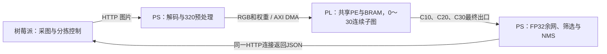

# YOLO26n on Zynq7020：铝材表面缺陷检测

本仓库是 **2026 年 AMD 自主选题赛道（3.3）的独立参赛提交版**，版权所有者为 **Landon Yang**。开发推进使用 [Yolo26n_on_Zynq7020](https://github.com/huddddle/Yolo26n_on_Zynq7020)；本仓库只纳入配套且可追溯的已验收基线，不修改开发仓库。

当前提交基线：`convrelu_0～30` 共 **31 个卷积节点**及相邻分支、残差、拼接在 PL 连续执行，后续网络在 PS 的 NCNN 中运行。它不是全网络 PL，也不是 31 套独立阵列。已验证版本固定为开发仓库提交 `dfd7f4f0c11e4edadc0b1743d16a116c45c8934d`，见 [来源清单](report/provenance.json)。后续研发实验未经配套验收不混入本提交版。

## 实测成果与边界

|同轮固定输入，CPU1 单线程|平均前向时间 ms|总体标准差 ms|
|---|---:|---:|
|纯 PS FP32|1240.163|1.572|
|PL0～21 对照|866.078|0.133|
|当前连续 PL0～30|869.309|0.439|

各路径轮换 **7 次记录，每次记录前预热 2 次**，同 bit、同 boot、同输入和 NCNN 配置。当前版本相对纯 PS 用时减少 **29.90%**，加速比约 **1.427**；相对 PL21 慢约 **3.231 ms**，不能把新增覆盖描述为新增净收益。该前向口径包含量化/布局、权重、DMA、计算、恢复及 PS 余网，不包含图片解码、参数构造、存图和 HTTP 往返。[原始计时](report/evidence/results.json)及[实板记录](board/evidence/benchmark.json)。

100 MHz 的原始签核：WNS **+0.008 ns**、WHS **+0.036 ns**，DRC 错误 0，12 类时序覆盖检查通过；**92 DSP、132.5/140 BRAM36 等效**。固定图整数出口与黄金参考匹配，**本基线未做全量 mAP**，不能以单图一致声称量化无损。详见[设计报告](report/design_report.md)、[指标表](report/metrics.csv)及[资源/时序原始报告](build/reports)。


## 平台、模型与架构

|项目|实现|
|---|---|
|开发板|野火 Zynq7020，`xc7z020clg400-2`，1 GiB DDR|
|硬件工具|Vivado **2022.2**；未为规范中的推荐版本擅自升级|
|板端系统|PetaLinux 2022.2 / Linux `5.15.0-xilinx` / ARMv7|
|PS 编译|Xilinx SDK 2018.3 ARM hard-float GCC 7.3.1，Cortex-A9 / NEON|
|推理库|NCNN `20260526`，提交 `e54f7b1f88434e1d844ea0551b880a1cfb079ce1`|
|模型|**YOLO26n**，ReLU，输入 `1×3×320×320`，5 类|
|数值格式|PL INT16 权重/输入块、INT8 特征、48 位算术、36 位部分和存储；PS 余网 FP32，非全模型 W8A8|
|输出|`out0=[1,9,2100]`；4 个坐标及 5 类分数|
|类别|`ca_shang` 擦伤、`zang_wu` 脏污、`zhe_zhou` 褶皱、`zhen_kong` 针孔、`zheng_chang` 正常|
|通信|HTTP `POST /predict`，文件字段 `image_file`；JSON 在同一连接返回|

大白话：树莓派拍照和展示结果，ARM 安排任务，FPGA 使用同一套计算阵列轮流执行前段卷积。中间结果留在片上，最后把旁路和出口送回 ARM，继续完成网络和检测后处理。

专业表述：采用 PS–PL 异构执行、共享 PE 分时调度与基于张量活跃期的 BRAM 复用。前段以 RGB888 整帧输入，PL 完成行缓存、窗口生成、卷积、偏置、定点重定标、ReLU、饱和及子图内部尺度对齐；C10/C20 长期旁路与 C30 作为最终出口返回 DDR，INT8→FP32 后注入 NCNN。HP0 已 64 位，DMA 内存侧及 AXIS 为 32 位直接模式，SG 未启用；每帧 47 事务，TX 2,911,888 B、RX 289,792 B。



树莓派应用属于[配套项目](https://github.com/Tony-Chen-dot/FPGA-AMD-RaspberryPi)。本仓库的推理验证不代替机械分拣闭环验证。

## 目录与规范对照

```text
FPGA_AMD_Zynq/
├── LICENSE                 # 原创代码 MIT；第三方与模型见许可范围
├── README.md
├── src/rtl/                # 与已验 bit 配套的 18 个 RTL 文件
├── src/ps_software/        # 推理、DMA客户端、UAPI与第三方说明
├── sim/                    # 测试台、97报文回放入口与校验测试
├── build/                  # 移植后的构建入口、完整BD及原始签核报告
├── board/                  # 配套bit/XSA/HWH/DT/内核身份、部署准备与实板证据
├── data/                   # YOLO26n部署模型、输入、黄金输出与压缩激励
├── skill/                  # 提示词工作流、排查清单与可复用校验程序
└── report/                 # 设计报告、AI协作记录、指标、来源与文件清单
```

|规范目录|本仓库位置|对应开发目录|
|---|---|---|
|src|src/rtl、src/ps_software|fpga/conv_accel/rtl、sw/petalinux|
|sim|sim、data/axis_vectors.txt.gz|fpga/conv_accel/tests、冻结AXIS激励|
|build|build、build/reports|fpga/conv_accel/setup、已验system报告|
|board|board/pl30、board/app、board/evidence|配套release、生产app、实板actual|
|data|data/model、data/reference|部署模型、同图黄金输出|
|skill|skill|从真实错误与验收中提炼的可复用工作流|
|report|report|结构化设计报告与真实协作摘录|

自定义路径均为小写英文、数字、下划线或连字符；扩展名及隐藏文件的点保留。按用户确认保留 `README.md`、`LICENSE`、`LICENSE.txt`、`AGENTS.md`、`HANDOFF.md`、`CMakeLists.txt`、`Makefile`、`SHA256SUMS`、`zImage` 等标准名称，具体例外见[命名规则](report/naming_policy.md)。GitHub 仓库名 `FPGA_AMD_Zynq` 按用户指定，不据此放宽内部自定义命名。

## 从零复现顺序

先取得本提交仓库；已经下载的用户直接进入第 1 步。**PowerShell 或 Bash，在准备存放项目的目录执行：**

```text
git clone https://github.com/huddddle/FPGA_AMD_Zynq.git
```

该命令下载提交源码和已归档材料，生成 `FPGA_AMD_Zynq/`；网络失败时先解决 GitHub 访问问题。随后进入该目录执行下面步骤；Windows PowerShell 使用 `Set-Location ./FPGA_AMD_Zynq`，Bash 使用 `cd ./FPGA_AMD_Zynq`，两者均只改变当前工作目录。

1. **先核对文件与身份。** 在仓库根目录、PowerShell 或 Bash 中执行：

```text
python -B skill/verify_submission.py
```

这是只读检查，预期 `passed=true`；校验名称、源文件、模型/服务绑定、bit/XSA、黄金激励及签核记录，不访问开发板。若失败，先查具体缺件或 SHA，不跳过检查。

2. **仿真、软件编译与硬件重建。** 分别见 [sim/README.md](sim/README.md) 和 [build/README.md](build/README.md)。已签核硬件产物与整理后的重建入口分开存放；本次整理不重新占用 Vivado 运行完整综合/布线。新重建仍必须独立通过时序检查，不能沿用历史 WNS。

3. **准备上传包及临时启动。** 见 [board/README.md](board/README.md)。整理程序会恢复板端 `Zynq7020.sh` 的既有名称，并核验原始服务清单。它本身不上传、不重启、不配置 PL。原厂 SD 默认启动不覆盖；不要在旧 Linux 运行中单独替换 bit。

4. **功能与数值检查。** 在匹配的实验 Linux 中执行固定输入检查；实际出口与 `data/reference` 比较，再启动 HTTP。不能把 CPU 输出和量化 PL 输出应当完全相同作为判据，两者各有独立黄金输出。

取回固定输入的 PL30 结果后，**PowerShell 或 Bash，在仓库根目录执行：**

```text
python -B skill/verify_submission.py --results D:/FPGA_AMD_Zynq_results/pl30_check --backend pl30
```

`--results` 指向实际下载的结果目录（按电脑路径替换），`--backend pl30` 同时核对 C10/C20/C30、18900 项尾网输出和 47 次事务的报告；预期 `inference_results.passed=true`。只读检查，不连接开发板。详细下载与验收顺序见 [board/README.md](board/README.md)。

5. **测量完整边界开销。** 各路径同条件轮换，保留所有 7 次记录和预热条件；前向、HTTP 往返和硬件嵌套计数分别报告。[已有实测与复测方法](report/design_report.md)。

## 开源范围与已知缺口

逐项材料位置和验收边界见 [参赛要求对照表](report/requirements_matrix.md)。本工程使用 Linux/NCNN，不把尚未实现的 PYNQ 加分项写为成果。

原创 RTL、原创用户态源码、整理工具与文档使用 [MIT](LICENSE)，署名 Landon Yang；GPL 内核客户端、NCNN、stb、YOLO26n 模型及由模型导出的权重不被重新许可为 MIT。详见[许可范围](report/license_scope.md)与[模型说明](data/model/README.md)。

本次验证覆盖固定输入、公开 AXIS、软件后处理和原始硬件/实板证据；未新增硬件构建、上板实验或全量精度评估。训练数据与训练脚本、完整原厂 PetaLinux 工程/SDK、整机分拣闭环证据尚未全部随包归档，不能宣称已完成干净环境全链路复验或完整重训。内核来源、ABI与获取材料见 [build/README.md](build/README.md)。
