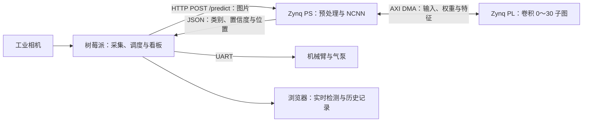

# 铝片表面缺陷检测与智能分拣 · Zynq-7020 端

本项目采用 **树莓派 + Zynq-7020 双板异构架构**，完成铝片图像采集、缺陷识别、分拣控制与检测记录查询。本仓库提供 **Zynq 开发板端工程**：PL 卷积加速器、PS 推理程序、HTTP 服务、构建脚本、上板文件及测试结果。

**另一块开发板的工程：[树莓派端 FPGA-AMD-RaspberryPi](https://github.com/Tony-Chen-dot/FPGA-AMD-RaspberryPi)**。树莓派负责工业相机采集、机械臂与气泵控制、检测看板和语音交互；两块板通过以太网 HTTP 接口交换图片与检测结果。

参赛项目：2026 全国大学生嵌入式芯片与系统设计竞赛 FPGA 赛道，AMD 自主选题初级组。团队成员为大三本科生，目标器件为 Zynq-7000 系列 **XC7Z020**。

## 系统分工



Zynq 的 PL 连续执行 `convrelu_0`～`convrelu_30`，共 31 个卷积节点及相邻分支、残差与拼接；PS 使用 NCNN 执行后续网络和检测后处理。PL 采用共享计算阵列分时调度，并按特征的使用周期复用 BRAM。

## 平台与接口

| 项目 | 配置 |
| --- | --- |
| 开发板 | 野火 Zynq7020，`xc7z020clg400-2`，1 GiB DDR |
| FPGA 工具 | Vivado 2022.2 |
| 板端系统 | PetaLinux 2022.2 / Linux `5.15.0-xilinx` / ARMv7 |
| PS 编译器 | Xilinx SDK 2018.3，ARM hard-float GCC 7.3.1，Cortex-A9 / NEON |
| 推理库 | NCNN `20260526`，提交 `e54f7b1f88434e1d844ea0551b880a1cfb079ce1` |
| 模型 | YOLO26n-ReLU，输入 `1×3×320×320`，五类 |
| 类别 | 擦伤、脏污、褶皱、针孔、正常 |
| 数值格式 | PL：INT16 权重/输入块、INT8 特征、48 位算术、36 位部分和；PS 后续网络：FP32 |
| 服务 | `POST /predict`，multipart 字段 `image_file`；同一请求返回 JSON；默认端口 8080 |
| 开发连接 | MobaXterm，通过 SSH 连接板端；串口用于 U-Boot 启动操作 |

Vivado 2022.2 是本工程的构建版本。比赛指南 §3.3.3.1 允许采用推荐版本以外的工具，要求说明版本并提供可复现脚本；版本选择及依赖见[构建说明](build/readme.md)。

## 测试结果

同一固定输入、同一硬件与启动环境、CPU1 单线程，三条路径轮换测试；每次记录前预热 2 次，每条路径记录 7 次。

| 推理路径 | 平均前向时间 / ms | 总体标准差 / ms |
| --- | ---: | ---: |
| 纯 PS FP32 | 1240.163 | 1.572 |
| PL0～21 | 866.078 | 0.133 |
| PL0～30 | 869.309 | 0.439 |

PL0～30 相对纯 PS 的前向用时减少 **29.90%**，加速比约 **1.427**；相对 PL0～21 增加 **3.231 ms**。计时包含量化与布局转换、权重传输、DMA、PL 计算、特征恢复及 PS 后续网络。图片解码、参数构造、存图和 HTTP 往返另行计时。

实现报告：**100 MHz，92 DSP，132.5/140 BRAM36 等效块，WNS +0.008 ns，WHS +0.036 ns，DRC 错误 0**。固定输入的整数特征与参考结果一致。原始数据见[计时记录](report/evidence/results.json)、[资源与时序报告](build/reports)、[指标表](report/metrics.csv)。


## 仓库目录

```text
zynq/
├── readme.md
├── license
├── src/       # RTL、PS 推理、DMA 客户端及第三方依赖说明
├── sim/       # 仿真与软件验证入口
├── build/     # Vivado Tcl、PS 编译入口、综合与实现报告
├── board/     # bit、xsa、hwh、设备树、服务与实测输出
├── data/      # 部署模型、固定输入与参考输出
├── skill/     # 提示词工作流、排错方法与文件/结果校验器
├── report/    # 设计报告、协作记录、海报与比赛指南
└── handoff.md # 工程交接记录
```

上述目录与比赛推荐结构一一对应。目录与文件名采用小写英文，保留扩展名和 Git 配置文件所需的点号；部署时使用的板端名称由脚本生成，见[命名说明](report/naming_policy.md)。

## 从零复现

### 1. 下载并检查文件

**PowerShell，在准备存放工程的目录执行：**

```powershell
git clone https://github.com/huddddle/FPGA_AMD_Zynq.git zynq; if ($LASTEXITCODE -eq 0) { Set-Location zynq; python -B skill/verify_submission.py }
```

`;` 分隔命令，`if` 保证下载成功后再进入目录并检查。需要 Git 和 Python 3.10+；`-B` 关闭 Python 字节码缓存。检查成功输出 `passed=true`，下载失败先处理网络或目录冲突，文件检查失败按输出定位路径。

### 2. 仿真与构建

- [仿真说明](sim/readme.md)：使用 Verilator 回放 97 个 AXIS 报文，并比较 144920 个返回字。
- [构建说明](build/readme.md)：准备 ARM32 编译器与 NCNN，构建 PS 程序；使用 Vivado 2022.2 执行 `build/build_pl30.tcl`，生成工程、bit、XSA 和本次资源/时序报告。

### 3. 准备系统并上板

按[上板说明](board/readme.md)准备野火板卡系统镜像和匹配的内核，运行部署准备脚本，上传服务与 PL 文件，通过 U-Boot 加载配套 bit、设备树及内核。随后比较固定输入结果，并启动 8080 端口的 HTTP 服务。

### 4. 连接树莓派

按[树莓派仓库](https://github.com/Tony-Chen-dot/FPGA-AMD-RaspberryPi)安装采集与控制软件，将其 `config.sh` 中的 `ZYNQ_IP` 设为本板地址。树莓派使用 `image_file` 字段上传图片，收到 JSON 后更新看板并调度分拣。接口字段见[HTTP 协议](report/http_protocol.md)。

**PowerShell，在本仓库根目录测试示例图片：**

```powershell
curl.exe --fail-with-body --max-time 30 -F 'image_file=@data/input_300.jpg;type=image/jpeg' 'http://192.168.10.111:8080/predict'
```

将 IP 改为实际板端地址。`-F` 上传 JPEG，`--max-time 30` 设置请求总超时，`--fail-with-body` 在 HTTP 错误时保留响应正文并返回失败；连接失败检查网段、服务端口及板端日志。

## 文档与材料

- [设计报告](report/design_report.md)、[大模型协作记录](report/ai_collaboration.md)、[技能包](skill/readme.md)。
- [中英双语海报及比赛指南](report/materials/readme.md)。海报记录 2026-11-02 的阶段实验，当前 PL0～30 指标见上文及设计报告。
- [提交材料对照](report/requirements_matrix.md)、[模型说明](data/model/readme.md)、[源码版本](report/provenance.json)。

## 已知局限与 TODO

- 当前 PL0～30 版本的精度验证以固定输入和参考输出为主；完整测试集 mAP 评估待补充。
- 训练代码、训练数据来源与授权说明待补充。
- 从源码重建原厂 Linux 所需的匹配内核源码、补丁、配置和公开获取方式待补充。
- 独立环境的完整重建记录，以及采集、推理、机械分拣整机联调的成功率和时延记录待补充。
- PL0～30 比 PL0～21 多 3.231 ms，BRAM 使用量为 132.5/140 等效块；后续优化重点是调度、数据搬运和片上重排开销。

## 开源协议

原创 RTL、用户态代码、工具和文档采用 [MIT](license)，署名 Landon Yang。模型及派生权重、Linux 内核客户端、NCNN、stb 和 AMD 工具生成内容保留各自许可，详见[许可说明](report/license_scope.md)。
