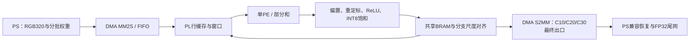

# 设计报告：YOLO26n在Zynq7020上的PS–PL协同推理

## 1. 背景与目标

铝材表面擦伤、脏污、褶皱、针孔和正常类别的边缘检测，需要在有限资源板卡上完成图像推理与通信。项目采用树莓派采集/展示/分拣控制，Zynq7020执行推理。本提交版的目标是可追溯的前段子图加速和复现；未以推理截图代替整机闭环成功率。

主要设计点为：单PE分时复用、按活跃期共享BRAM、RGB整帧前端与行缓存、卷积/偏置/定点重定标/ReLU融合，以及0～30间特征的片上交接。它们是本工程的具体设计取舍，不声称未经文献查新的首创性。

## 2. 原理与软硬件划分

大白话：ARM擅长处理图片、通信和灵活调度；FPGA负责反复做卷积乘加。前段中间结果放在片上反复使用，避免每个小卷积都出片再回来。最后保留模型需要的长期旁路，让ARM继续跑余网。

专业表述：PS完成JPEG解码、等比例缩放/114补边、任务构造、AXI DMA和NCNN尾网；PL复用3输入通道×16输出通道PE，跨输入块累加后执行偏置、定点缩放、RNE舍入、ReLU和饱和。INT16权重/输入块、INT8特征、48位算术与36位部分和存储按已证明范围使用，不能推广为任意网络形状均成立。输出回PS需一次INT8×尺度兼容转换。

## 3. 接口与缓存

控制报文使用32位AXIS、TKEEP/TLAST边界与AXI DMA直接模式；V2驱动每方向512KiB。每帧47事务，TX2911888B、RX289792B。等待区间包含拷贝、DMA、PL、反压及通知，不能称为纯DMA带宽。HTTP为multipart图片输入与同一连接JSON响应，协议见 [http_protocol.md](http_protocol.md)。

72块共享特征BRAM按张量生命周期复用；C6/C11/C21经片上捕获和整理供下一子图，内部卷积、残差和Concat不经DDR重导入。C10/C20在各自最后使用后仅最终回传供PS长期旁路，C30为前段出口。详细分配见 [memory_plan.json](evidence/memory_plan.json) 和 [bram_usage.json](evidence/bram_usage.json)。容量、端口、实际原语与布线时序分别验收，不用张量总字节数直接推断BRAM块数。

## 4. 优化前后对比

同一硬件和启动、CPU1单线程、同固定RGB输入，packing/lightmode开启；三路径轮换，每记录预热2次，保留7次实测。均值/总体标准差如下。

|路径|ms|标准差ms|相对纯PS|
|---|---:|---:|---:|
|纯PS FP32|1240.162971|1.572450|基准|
|原PL0～21|866.078449|0.133282|约30.16%更少用时|
|连续PL0～30|869.309115|0.438805|29.9036%更少用时|

连续PL30比PL21多3.230666ms，七轮均未取得新增净收益。尾网621.285314→573.848410ms省47.436904ms，但前段244.083100→294.424602ms多50.341502ms；22～30任务46.409118ms，三段片上重排合3.487773ms。总前向还有提取器/调用等未归入两段的开销，不把两段相减强行等同总差。

|资源|纯PS使用PL加速资源|当前PL30|
|---|---|---|
|PE|0|1个共享阵列|
|DSP|0个加速DSP|92/220|
|BRAM36等效|0块加速BRAM|132.5/140|
|时钟|不适用|100MHz|
|WNS/WHS|不适用|+0.008/+0.036ns|

“纯PS”资源列仅指本加速器，不宣称厂家整体bit没有使用PL资源。完整LUT/FF及资源占用率由 [resource_summary.json](resource_summary.json) 和 [utilization.rpt](../build/reports/utilization.rpt)给出，未把不同实现轮次资源混算。8ps建立余量较小，改RTL或构建后必须重新签核。

## 5. 功能与实板证据

原生产顶层97个公开AXIS报文、两帧及旧模式回归通过，比较144920个返回字；C10/C20/C30整数和18900尾网值匹配冻结参考。原实板两路中断计数与事务数符合，完整原始数值及日志在 [board/evidence](../board/evidence)。CPU与PL的FP32输出不相同是量化路径的独立数值契约，不将其误判为电路错误。

HTTP单图300×300 JPEG：直接程序与HTTP五个擦伤检测的类别、分数、原图坐标一致；前向849.010ms，电脑往返1500.079ms。它是单次功能口径，与七轮预热均值不同；不推断P95/P99、总体mAP、闭环分拣成功率或功耗。本基线全量mAP未测。

## 6. 大模型协作与技能提炼

开发以读取真实模型/报告→提出边界方案→数值oracle与接口回归→完整物理签核→固定图实板→同轮边界计时为主。发现问题时保留失败证据，区分方案、仿真、物理与实板状态。提示词模板、适用条件、失败边界及来源在 [skill/README.md](../skill/README.md)，真实摘录和本次纠错在 [ai_collaboration.md](ai_collaboration.md)。

## 7. 复现与限制

按根README先校验文件，再运行仿真与交叉编译；可使用已验启动包，或重建后重新签核。按board说明临时加载匹配bit/DT/内核，先单图整数验收再启动HTTP。所有输出写独立工作目录，原厂默认启动文件保留。此仓库整理未重新上板，也未承诺已完成不同机器/板卡的从零复验。

当前限制：仍有FP32尾网和47次权重/任务调度；共享供数与片上整理有开销；BRAM接近上限；训练材料、厂商完整匹配Linux源码构建环境和机械分拣闭环材料未全量归档。后续子图仅在配套数值、时序与净收益验收后加入提交版，不根据研发层号自动扩展声明。
